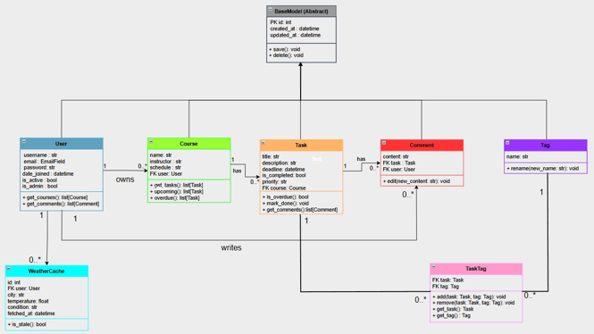

# Smart Student Planner
A Django-based web application that helps students manage their academic courses, tasks, and deadlines effectively.

---

##  Project Overview

Smart Student Planner is designed for students who struggle with managing multiple courses and overlapping deadlines. The application provides a single place to organize courses, track assignments, and monitor study progress.

---

##  Features

### Must-Have Features
- **User Authentication** - Registration, login, and logout
- **Course Management** - Create, edit, and delete courses
- **Task Management** - Create tasks with title, description, deadline, and priority
- **Dashboard** - Overview of upcoming and overdue tasks
- **Weather Integration** - Real-time weather based on your location
- **Admin Panel** - Django admin panel for managing users and data
- **Comments on Tasks** - Add notes to tasks

### Nice-to-Have Features
- Task priority levels (low, medium, high)
- Filtering and sorting tasks

---
### Project Structure & Class Diagram


---

##  Setup Instructions

### Clone the Repository

```bash
git clone https://github.com/IMC-UAS-Krems/assignment-2-ihorkozak
cd TaskManager
```

### Create a Python Virtual Environment

#### On Windows (PowerShell):
```bash
python -m venv venv
venv\Scripts\activate
```

#### On macOS / Linux:
```bash
python3 -m venv venv
source venv/bin/activate
```

### Install Dependencies

```bash
pip install -r requirements.txt
```

### Run Migrations

```bash
python manage.py migrate
```

### Start the Server

```bash
python manage.py runserver
```

### Open in Browser
http://127.0.0.1:8000/
---


## Running Tests

## Test Users
- Admin: username `admin`, password `imc-admin`
- User: username `user1`, password `imc-user`
- User: username `kozak`, password `!12345qwert`
### Run All Tests
```bash
pytest planner/tests.py -v
```
---

##  Features Overview

### Dashboard
- Shows upcoming tasks sorted by deadline
- Highlights overdue tasks
- Displays current weather for your location

### Courses
- Create courses with name, instructor, and schedule
- View all your courses
- Delete courses

### Tasks
- Create tasks linked to a course
- Set deadline and priority (low, medium, high)
- Mark tasks as completed
- Add comments to tasks
- View task details

### Tags
- Create tags
- Add tags to tasks

### Weather
- Automatically detects your city by IP
- Shows temperature and weather condition


---

##  Technologies

- **Language:** Python 3.13
- **Framework:** Django 6.0
- **Database:** SQLite
- **API:** OpenWeather API
- **Testing:** pytest

---

## Demo

YouTube video: https://youtu.be/1JdMLHLZgYA